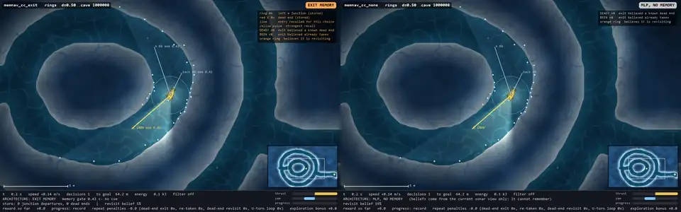
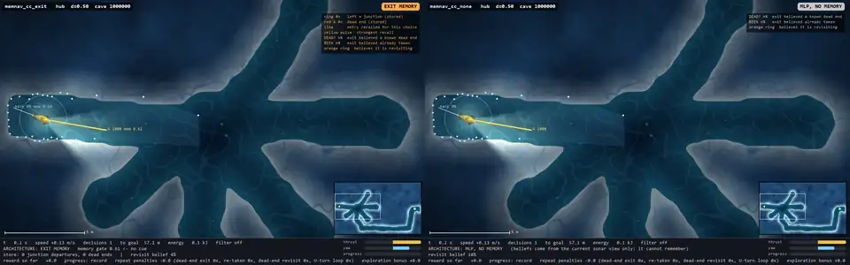
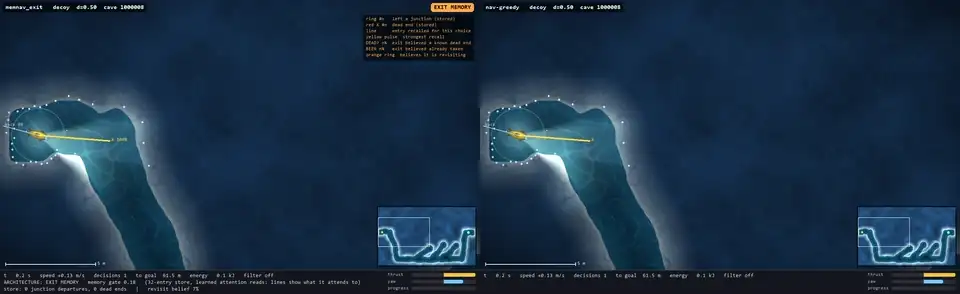
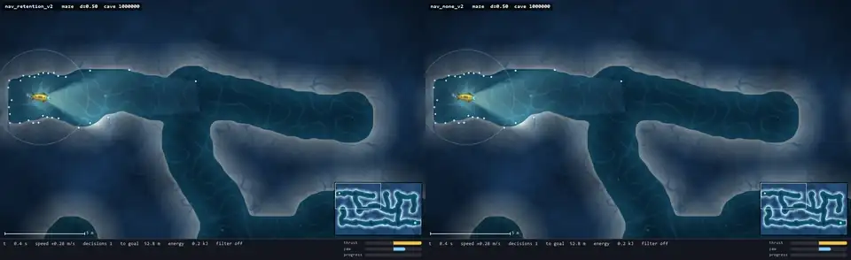
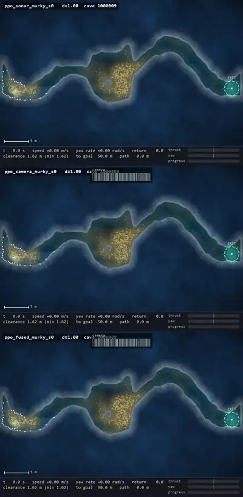
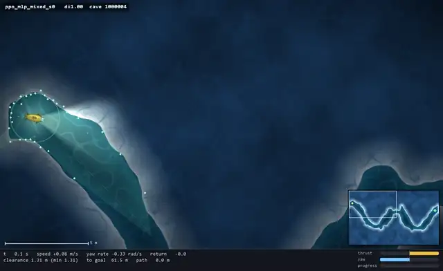
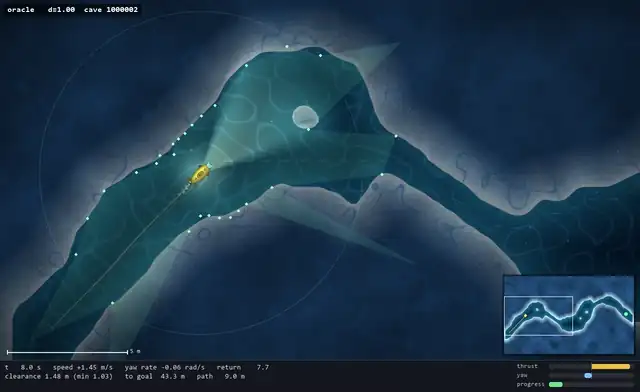

# 🌊 Submarine Cave Navigation

**Teaching an autonomous submarine to find its way out of underwater caves using only sonar, and to *remember*
where it has already been.**


[](LICENSE)

**[Demos](#demos)** · **[Results](#results)** · **[How it works](#how-it-works)** · **[Getting started](#getting-started)** ·
**[Workflow](#workflow)** · **[Documentation](docs/README.md)**



<sub>**Blind dive, same cave, side by side** (4× speed). Left: the v3.3 memory model stores each junction it leaves,
recognises the ring it has already been round, and gets out in 61 s, as fast as the oracle. Right: its memoryless
twin, trained identically, goes back round the ring and times out.</sub>

---

## In 30 seconds

- 🗺️ **The world:** procedurally generated 2D ice caves: mazes, dead ends, glacier cracks, boulder chokes, murky
  water, sensor failures and currents. Every cave is new; every test cave is unseen in training.
- 🧠 **The agent:** two levels. A **driver** steers at 10 Hz behind a built-in safety filter: **0 crashes in 600
  test dives**. A **navigator** decides only at junctions which passage to take, using a learned **exit memory**.
- 🏆 **The result:** on caves built so that only memory helps, the memory navigator beats its identical
  memoryless twin by **+13 points** (71.7% vs 58.3%), with ~20–30% fewer dead-end re-entries.
  Over the same caves it wins 22 head-to-heads to 7 (**p = 0.008**).
- 🔬 **The lesson:** getting there took two navigator rounds and four memory versions. The architecture was fine by v3.2; what was missing
  was **caves where forgetting actually costs something**.

## Demos

Replays show the sonar, stored memories, recalled entries, the memory gate and the agent's beliefs live. The
rings dive is at the top of this page; more below. Previews are compressed, sped-up excerpts (4× real time, 8× for
the round-2 maze) made with `scripts.make_preview`. The full-quality `.mp4` files are git-ignored; see
[videos/](videos) for the curated clips and the [workflow](docs/workflow.md#8-record-the-comparison-videos) for how
to record them.

### ⭐ v3.3: memory finds the way out of the hub

**Left:** v3.3 exit memory. **Right:** its memoryless twin. Most spokes of the chamber are dead ends pointing at the
exit, and every one leads back to a chamber that looks the same. The memory model gets out in 82 s; the twin, v3
and the wall follower all time out.



### v3: the decoy that traps greedy

**Left:** v3 exit memory. **Right:** greedy (always follow the goal bearing). A side passage points straight at the
exit and ends blind. Greedy keeps being pulled back into it; the memory navigator exits in 58 s.



### Round 2: retention memory solves the maze

**Left:** the retention-memory navigator. **Right:** the same navigator without memory. Retention memory is the only
learned navigator to get out of this maze (144 s); without memory it times out.



### Two senses beat one in murky water



The same hard, murky cave, three agents, top to bottom:
- **sonar only** misses the narrow exit, detours round a pillar and crashes (24.2 s);
- **camera only** crashes in thick silt (19.6 s);
- **sonar + camera** reaches the exit (34.5 s).

Fused, the agent succeeds on 86% of the hardest murky caves, against 64% with either sense alone.

<br clear="right">

### PPO clears a hardest-level cave

Follow camera on the PPO agent trained with a difficulty curriculum: through the hardest cave level in 42 s, with
the minimap and the sonar's view of the walls.



### The game-style renderer

Ice theme, follow camera, minimap, headlight, caustics, bubbles and sonar pings (the oracle driving).



## The journey

Each step asked one question. The answers, good and bad, shaped the next one.

| # | Stage | Question | Answer |
|---|---|---|---|
| 1 | Classical baselines | How far do hand-written controllers get? | Gap following: 80%, but only **34%** on the hardest caves |
| 2 | PPO, easy caves only | Does RL learn to drive? | Only what it saw: **31%** overall, it learned to chase the goal bearing, not to avoid walls |
| 3 | PPO, mixed difficulty | And with a curriculum? | ✅ **94%** overall, **82%** on the hardest caves (oracle 100%) |
| 5 | Sonar + camera in murky water | Do two senses beat one? | ✅ Fused **93%** vs sonar 88%, camera 84%; on the hardest caves 86% vs 64% |
| 7 | End-to-end memory agents | Can one network drive *and* remember? | Memory cut maze dead-end re-entries **~11×**, but crashes ate every gain |
| A | Driver + safety filter | Split driving from deciding? | ✅ **0 crashes in 150** test dives, learned driver as good as the hand one |
| B | Navigators (round 2) | Does memory help a navigator that can't crash? | ✅ Retention memory **88.7%** vs greedy 82.0% (p = 0.006); **0 crashes in 600 dives** |
| v3 | Exit memory + auxiliary losses | Can memory answer "what do I know about *this* exit"? | ❌ It *knew* (85–90% recall) but the policy **ignored it** |
| v3.1 | A reward that prices forgetting | Will paying for memory make it used? | ❌ Both models explored more; **no memory still did best** |
| 🔍 | Diagnosis | Why does memory keep losing? | **The caves never needed it:** a wall follower solves them all |
| 🕳️ | Memory caves: `rings`, `hub` | Build caves only memory can solve | Every reactive rule collapses: greedy **5%**, wall following 37–42%, oracle 100% |
| v3.2 | Event-triggered memory gate | Use memory *when it matters*? | ✅ Gate 0.83 at known dead ends vs 0.40 at fresh junctions, but RL still pruned it |
| **v3.3** | **v3.2 trained on the memory caves** | **Does memory finally pay off?** | ✅ **71.7% vs 58.3%** for its memoryless twin, **p = 0.008** |

Every milestone is a git tag (`phase-b-round1`, `phase-b-round2`, `v3`, `v3.1`, `v3.2`, `v3.3`):
`git checkout v3.2` brings back that exact version.

## Results

### Driving: learning to get through

Success on unseen test caves.

| | All difficulties | Hardest caves (d = 1) |
|---|---|---|
| Gap-following controller | 80% | 34% |
| PPO trained on easy caves only | 31% | 2% |
| **PPO trained on mixed difficulty** | **94%** | **82%** |
| Oracle with the true map (upper bound) | 100% | 100% |

### Seeing: murky water and slow sonar

| | All difficulties | d = 1 |
|---|---|---|
| Gap follower | 72% | 26% |
| PPO, camera only | 84% | 64% |
| PPO, sonar only | 88% | 64% |
| **PPO, sonar + camera** | **93%** | **86%** |

### Remembering: the memory caves (v3.3)

Two cave types designed so that no reactive rule works:
- **`rings`:** the dive starts *inside* two concentric rings of passage. Keep a hand on either wall and you circle
  a pillar of rock forever; the goal bearing keeps saying "carry on round". Getting out needs *"I've been here"*.
- **`hub`:** one chamber with 3–5 spokes. Most are dead ends **pointing at the exit**; the true route leaves at
  ~90°. Every failed spoke returns the sub to the same chamber, which looks the same: only remembering which spokes
  were tried moves it on.

30 unseen caves of each type:

| | With goal cue | Blind (no cue) | Dead-end re-entries per dive (cue / blind) | Known dead end avoided |
|---|---|---|---|---|
| **v3.3 exit memory** | **71.7%** | **68.3%** | **1.10 / 1.02** | **73%** |
| v3.3 twin, no memory (identical training) | 58.3% | 56.7% | 1.35 / 1.45 | 61% |
| v3.2 event gate (not trained on these caves) | 48.3% | 55.0% | 1.22 / 1.62 | 70% |
| v3 exit memory | 58.3% | 56.7% | 1.32 / 1.22 | 45% |
| Wall follower / greedy | 41.7% / 5.0% | | 2.10 / 3.17 | |
| Oracle (reads the map) | 100% | | 0.02 | |

On the old cave types it lost nothing: **74.7%**, the best v3 model there (its twin 70.0%; greedy 82.0% still
leads, because on those caves following the goal bearing is enough).

## How it works

```
            +---------------- NAVIGATOR (learned, decides rarely) -------------+
  sonar --> | openings detector -> candidates [opening 1 .. k, "turn back"]   |
  goal  --> | exit memory: junctions left, dead ends found, places revisited   |--> "take opening k"
  pose  --> | acts only at decision points: junction, dead end, or every ~2 s |
            +------------------------------------------------------------------+
                                          | target heading + speed
            +---------------- DRIVER (always on, part of the agent) ----------+
            | heading/speed tracking controller -> SAFETY FILTER -> thrust/yaw |--> 10 Hz control
            | blindness supervisor (stop / think / act slowly / abort)         |
            +------------------------------------------------------------------+
```

- **The safety filter is part of the agent**, on in training and testing alike. It predicts the stopping path of
  each command against the walls the sonar sees and only lets safe ones through, so the navigator can never learn
  to ram walls.
- **The navigator makes ~30–75 decisions per dive** instead of ~1,500 network calls, which makes memory
  learnable: each memory entry means something concrete, like *"at this junction I took the left passage; it was
  a dead end"*.

### The exit memory (v3.3)

```
 observation --> encoder --> GRU ----------------------------------------- context
                               |
 STORE (32 entries)            |  write when leaving a junction, or on reaching a dead end;
   position, heading, memo     |  same place again -> update that entry (no duplicates)
                               v
 for each exit k:   LOCAL read "did I leave from HERE along this exit?"
                    AHEAD read "is there a known dead end DOWN this exit?"
                               |
         EVENT GATE per exit: opens after a dead end, a turn-back, a revisit, no new ground ...
                               v
 exit scorer + BELIEF BIAS ("I believe this exit is a dead end" lowers its score) -> choice
 auxiliary heads, trained from simulator ground truth: loop closure, "taken before", "known dead end"
```

Every piece comes from published navigation-memory work (Neural Map, Scene Memory Transformer, Nav A3C, MERLIN,
GTrXL, Memory Maze); [docs/memory_v3.md](docs/memory_v3.md) gives the reasoning and sources.

## The memory story

<details>
<summary><b>Why did it take so many versions? (click to expand)</b></summary>

1. **v3: the memory knew, the policy didn't listen.** Auxiliary losses taught the memory its facts (85–90% recall
   of "this exit leads to a known dead end"), but its single gate stayed at ~0.17. The exit scorer could rescale
   the same features itself, so the gate never got a learning signal.
2. **v3.1: paying for memory made it explore, not remember.** A reward that pays only for new ground and charges
   for repeats made both models try untried exits 2–4× more often, but the *memoryless* model still did best.
3. **The diagnosis: the caves never needed memory.** A memoryless policy re-entered dead ends as rarely as the
   oracle (0.26 vs 0.24 per dive), so it must have learned a reactive rule. The classic one, *keep a hand on the
   wall*, solves any cave whose start and exit share a wall, and every cave so far did. So we built
   **`rings` and `hub`**, where every reactive rule collapses.
4. **v3.2: memory that switches on when it matters.** A per-exit gate driven by events (a dead end just hit, a
   turn-back, a revisit) learned to open at known dead ends (0.83) and stay half-closed at fresh junctions (0.40). A
   belief bias turned "I know this is a dead end" directly into avoiding it (61–70%). But trained on caves where
   memory didn't pay, RL pruned the rich memory and kept only that simple rule.
5. **v3.3: the same model, trained where forgetting costs.** With rings and hub in the training mix, memory finally
   won: **+13 points** over its twin, p = 0.008. One detour on the way: a faster training setup reached only
   36.7%, so it was dropped and v3.3 kept v3.2's exact settings.

**Still open:** the hardest rings / hub caves defeat every learned model, blind on the old maze / decoy / loops
caves the twin is slightly ahead (72.2% vs 68.9%, not significant), and greedy still wins on caves where following
the bearing is enough.

Full lab notebook, with every table: [docs/memory_v3.md](docs/memory_v3.md).
</details>

## Scenarios

| Scenario | Real-world analogue | What the agent must do |
|---|---|---|
| Winding tunnel, d up to 1 | normal cave passage | drive fast without touching walls |
| Crevasse with 1.4 m squeezes | glacier crack | slow down and thread the squeeze, never ram |
| Maze with dead ends | multi-passage cave system | back out and try an *untried* exit |
| Misleading side branches / decoys | side passages that head for the goal and end blind | enter a decoy at most once |
| Loops and **rings** | passages that circle a pillar of rock | notice "I've been here" and take a new exit |
| **Hub** | a chamber where several passages meet, most blind | come back and pick a *different* passage |
| Boulder choke | breakdown chamber | find the gap among debris |
| Murk / silt-out | silted water, camera useless | rely on sonar, keep moving safely |
| Sonar or camera failure | equipment fault | stop, wait, creep slowly, abort if blind too long |
| No goal cue | exploring for an unknown exit | explore systematically without re-exploring |

## Getting started

Requires Windows or Linux and Python 3.12. A GPU is optional: these networks train faster on the CPU.

```powershell
py -3.12 -m venv .venv
.\.venv\Scripts\Activate.ps1            # Linux/macOS: source .venv/bin/activate
pip install -r requirements.txt
pytest                                  # full suite

# drive the submarine yourself (arrows/WASD, R restart, N/P next/previous cave)
python -m scripts.drive --difficulty 0.5 --theme rock --camera full

# look at the cave types
python -m scripts.plot_scenarios                            # -> docs/figures/scenario_catalogue.png
```

For the full loop (demos → training → evaluation → videos), see [Workflow](#workflow).

**Reproduce v3.3** (about 3 h for the memory model, 1.5 h for its twin, on CPU):

```powershell
python -m scripts.collect_nav_demos --config configs/memnav_caves_clean.yaml --workers 8 --out runs/memnav_c_demos.npz
python -m scripts.train_memnav --config configs/memnav_caves_clean.yaml --variant exit    # -> runs/memnav_cc_exit
python -m scripts.train_memnav --config configs/memnav_caves_clean.yaml --variant none    # -> runs/memnav_cc_none
python -m scripts.eval_navigator --config configs/memnav_reward.yaml --layouts rings hub --policies greedy oracle wall-left --models runs/memnav_cc_none runs/memnav_cc_exit
python -m scripts.compare_videos --config configs/memnav_caves_clean.yaml --reward-stage m3_full --no-cue --layouts rings hub --navigators runs/memnav_cc_exit runs/memnav_cc_none oracle --csv runs/eval/memcaves_cue_episodes.csv --out videos/10_memory_caves_clean
```

<details>
<summary><b>More commands: evaluate, train the end-to-end agents, record replays</b></summary>

```powershell
# evaluate baselines on held-out caves (tables + CSV + path plots)
python -m scripts.evaluate                                   # all baselines, 50 caves x 5 difficulties
python -m scripts.evaluate --policies gap oracle --models runs/archive/ppo_mlp_mixed_s0 --layout maze --max-steps 1500
python -m scripts.evaluate --config configs/eval_murky.yaml --policies gap oracle --models runs/archive/ppo_fused_murky_s0

# train an end-to-end agent (outputs in runs/<name>_s<seed>/), watch with: tensorboard --logdir runs
python -m scripts.train --config configs/ppo_mixed.yaml
python -m scripts.train --config configs/ppo_fused_murky.yaml --seed 1

# replay videos (several policies side by side on the same cave)
python -m scripts.record --policies gap --models runs/archive/ppo_mlp_mixed_s0 --difficulties 0.75 1.0 --caves 2
python -m scripts.record --models runs/archive/ppo_mlp_mixed_s0 --difficulties 1.0 --camera follow --format gif
```
</details>

## Workflow

Every experiment here follows the same loop, each step a script:

```
 config ─► smoke test ─► teacher demos ─► train model + control ─► monitor
                                                                     │
 document + tag ◄─ README preview ◄─ record videos ◄─ pick caves ◄─ evaluate
```

| Step | Command | Output |
|---|---|---|
| Train | `python -m scripts.train_memnav --config configs/<cfg>.yaml --variant exit` (and `none`) | `runs/<prefix>_<variant>/` |
| Monitor | `python -m scripts.watch_training runs/<run> ...` | live table, TensorBoard in `runs/<run>/tb` |
| Evaluate | `python -m scripts.eval_navigator --models runs/<run> ... --layouts rings hub --name <name>` | `runs/eval/<name>_episodes.csv` |
| Pick caves | `python -m scripts.pick_showcase --csv ... --winner <run> --losers <control>` | `layout:seed` pairs |
| Record | `python -m scripts.compare_videos --navigators runs/<run> ... --extra <layout:seed> --out videos/NN_<topic>` | side-by-side `.mp4` + README table |
| Preview | `python -m scripts.make_preview <a>.mp4 <b>.mp4 --duration 18 --out docs/media/<name>.webp` | WebP for the README |

**Step-by-step guide with every option, conventions and pitfalls: [docs/workflow.md](docs/workflow.md).**

## Under the hood

<details>
<summary><b>Features</b></summary>

- **Procedural caves** from an integer seed, with a difficulty knob d ∈ [0, 1]: width, cracks down to 1.7 m,
  rough walls, pillars, winding paths. Every cave is checked to be solvable; train / validation / test seeds are
  disjoint.
- **Cave layouts modelled on real exploration hazards:** tunnel, maze, misleading branches, crevasse, boulder
  choke, decoy, loops, rings, hub; plus a silt-out scenario.
- **Vehicle:** thrust with drag, a lagged turn-rate command, optional water current, energy model; 10 Hz control.
- **Sensors:** 32-beam 360° sonar (noise, dropout, ping rate, field of view, beam width); a forward camera with an
  underwater image model (attenuation, backscatter, speckle); murky patches that blind the camera but not the sonar.
- **Robustness:** random sensor failures (flagged and silent), tiered blindness supervisor, hull-damage contact
  model, dead reckoning with drift, junction / dead-end detector.
- **Training:** PPO, SAC, RecurrentPPO (Stable-Baselines3) for the driver; a custom stored-state recurrent PPO
  with auxiliary losses and teacher warm start for the memory navigator; curricula; YAML configs; TensorBoard;
  memory-light parallel workers (~58 MB each).
- **Baselines:** random, follow-the-gap, wall centering, greedy, wall followers (left / right), and an oracle
  planner on the true map.
- **Evaluation:** success / collision / timeout, path efficiency, clearance, energy, dead-end re-entries, memory
  reliance probes; every policy faces identical caves, noise and currents.
- **Visualization:** game-style renderer (ice or rock theme, follow camera, minimap), analysis view, side-by-side
  MP4 / GIF replays with live memory overlays, keyboard driving.
</details>

<details>
<summary><b>The environment in one table</b></summary>

| | |
|---|---|
| World | 50 m × 30 m, 0.2 m grid, top-down 2D |
| Action (driver) | `[thrust, yaw command]` ∈ [−1, 1]², 10 Hz |
| Action (navigator) | one of the detected openings, or turn back |
| Vehicle | max 1.5 m/s (reverse 0.75), turn rate up to 1 rad/s with 0.3 s lag, disc radius 0.4 m |
| Observation (sonar) | 32 ranges + speed + yaw rate + goal bearing/distance + previous action |
| Observation (camera) | `{"camera": 1×64 image, "state": vector}` |
| Reward (driver) | +1 per metre of shortest-path progress, −0.01 per step, −0.01‖Δa‖², +20 goal, −10 collision |
| Reward (navigator, v3.1+) | paid only for record progress; small penalties for repeating dead ends and U-turn loops; exploration bonus in blind dives |
</details>

<details>
<summary><b>Project structure</b></summary>

```
submarine/
  world/       procedural cave generator, scenario layouts (incl. rings, hub), geodesic distance, seed splits
  sim/         vehicle dynamics, sonar, camera, turbidity, simulator
  env/         Gymnasium environment, config, torch-free workers for parallel envs
  control/     driver: openings detector, heading/speed controller, integrated safety filter, learned driver
  navigator/   decision-level environment, greedy / oracle / wall-follower navigators
  memory/      retention + junction memory (round 1-2); exit memory exitmem.py and its trainer (v3+)
  agents/      training config, model/env factory, CNN extractor, callbacks, parallel envs
  baselines/   random, gap follower, wall centering, oracle planner
  evaluation/  metrics, dead-end analysis, parallel evaluation
  render/      game-style viewer, art, replay videos with memory overlays
scripts/       train_*, collect_nav_demos, eval_navigator, pick_showcase, compare_videos, make_preview,
               drive, evaluate, record, watch_training, plot_*, ...
configs/       YAML configs (memnav_caves_clean.yaml = v3.3)
tests/         pytest suite
docs/          workflow, design, development log, memory lab notebook; figures/, media/ (README previews)
videos/        curated replay clips by stage (git-ignored)
runs/          training runs and evaluations (git-ignored)
```
</details>

<details>
<summary><b>Configurations</b></summary>

| File | Purpose |
|---|---|
| `default.yaml` | All environment settings with their defaults |
| `ppo_d0.yaml`, `ppo_mixed.yaml` | PPO on easy caves only / mixed difficulty |
| `ppo_fused_murky.yaml`, `ppo_sonar_murky.yaml`, `ppo_camera_murky.yaml`, `eval_murky.yaml` | Sensor experiment in murky water |
| `scenario_siltout.yaml`, `eval_layouts.yaml` | Silt-out scenario; evaluation conditions for the cave layouts |
| `memnav.yaml` → `memnav_reward.yaml` → `memnav_event.yaml` → `memnav_caves_clean.yaml` | Memory navigator v3 → v3.1 → v3.2 → **v3.3** |

`learning_rate: lin_3e-4` means linear decay to 0. `features_extractor_class: camera_state` selects the CNN.
</details>

<details>
<summary><b>Practical notes</b></summary>

- **Windows memory:** SB3's `SubprocVecEnv` loads PyTorch in every worker (~2 GB each with the CUDA build). The
  default `vec_env: light` uses torch-free workers (~58 MB each), and the scripts cap NumPy's BLAS threads.
- **Several trainings at once:** use `--threads` so learners don't oversubscribe the CPU.
- **GPU:** not worth it here. Acting one step at a time is slower on the GPU; end-to-end training was 2.7× slower,
  and the memory navigator's learner was measured slower too. Its memory reads run as batched matmuls on the CPU.
- **Reproducibility:** caves, sensor noise and currents are seeded; evaluation uses fixed per-episode seeds, so
  replays reproduce the evaluation numbers exactly.
</details>

## Documentation

| | |
|---|---|
| 🛠️ [Workflow](docs/workflow.md) | how an experiment goes from config to video, step by step |
| 📐 [Design](docs/context.md) | goals, world, vehicle, sensors, reward, research questions |
| 📓 [Development log](docs/progress.md) | every stage, with results and figures |
| 🧠 [Memory lab notebook](docs/memory_v3.md) | v3 → v3.3, every experiment and table, including what failed |
| 🎬 [Scenarios](docs/scenarios.md) | the progression told through one example dive |
| 🎥 [Videos](videos/README.md) | the curated replay clips |

## License

[MIT](LICENSE)
