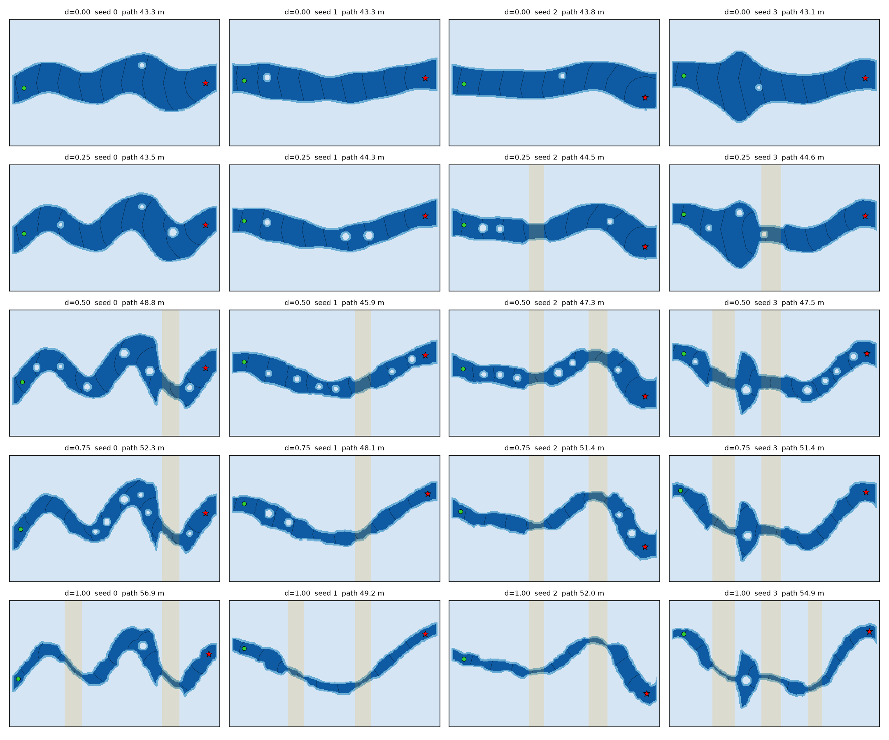
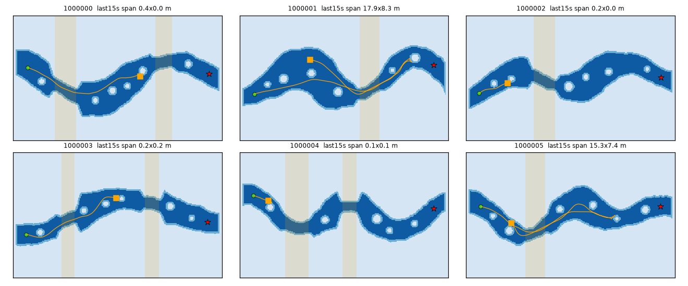
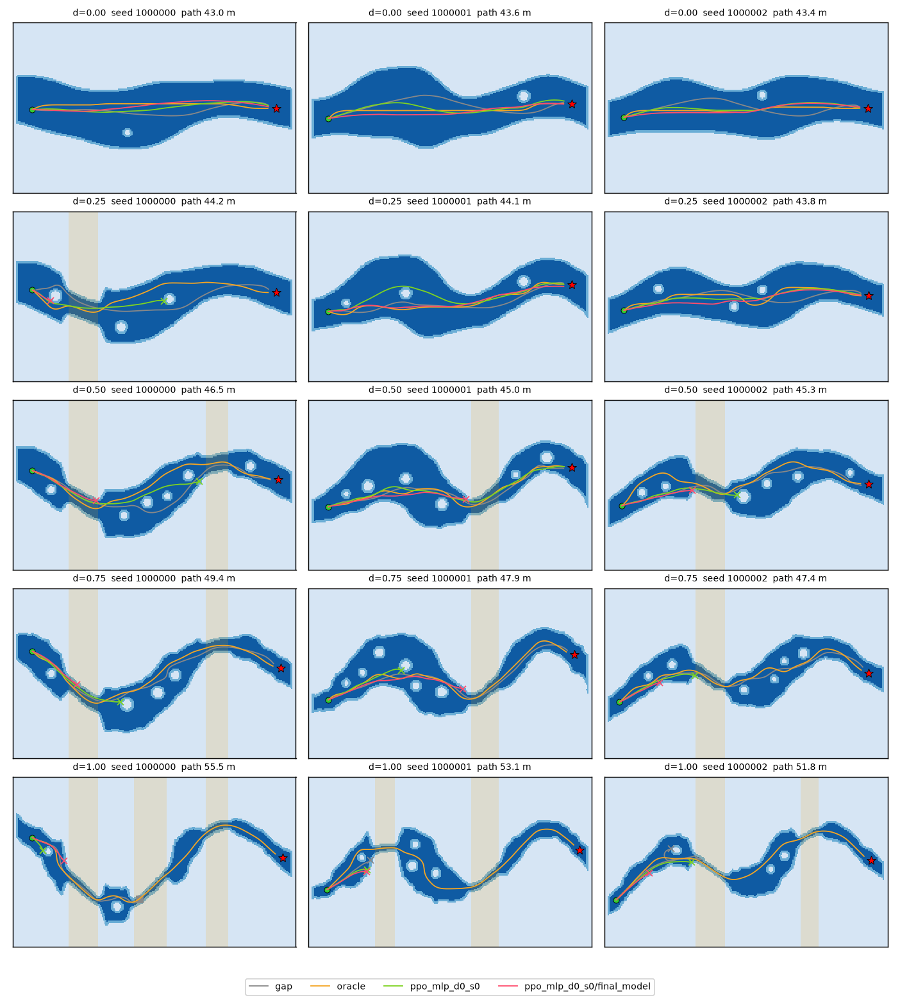
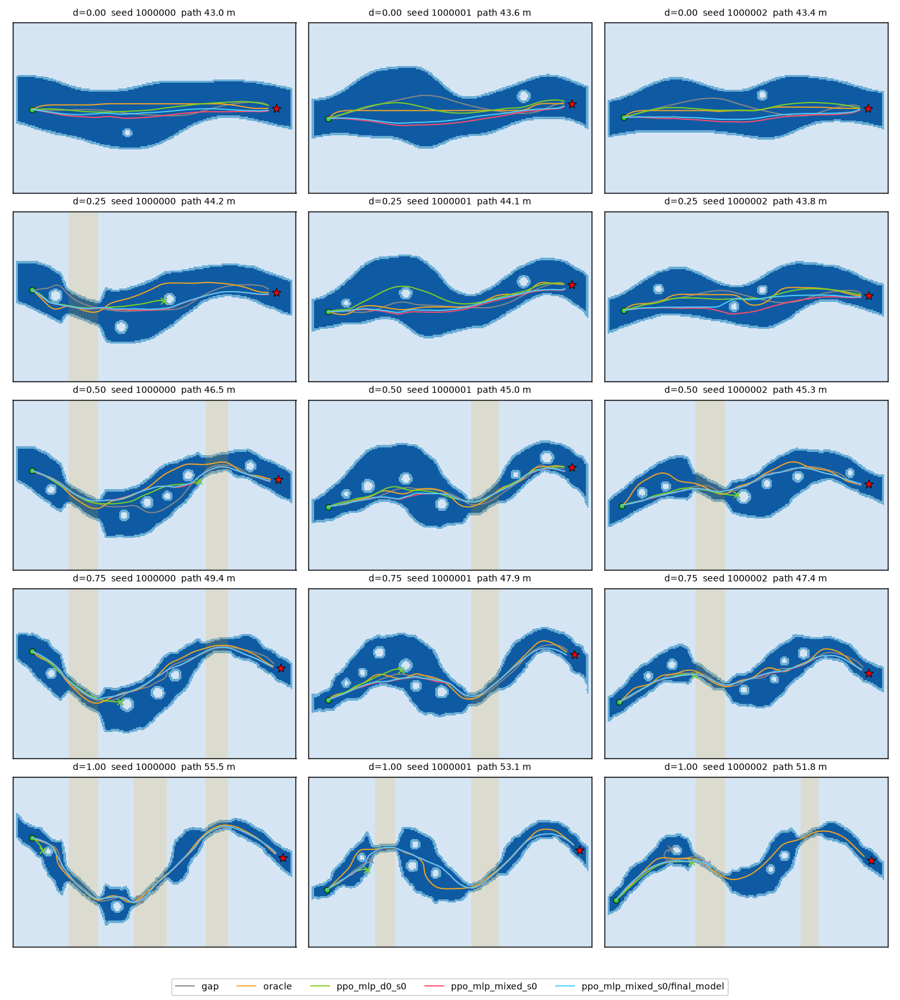
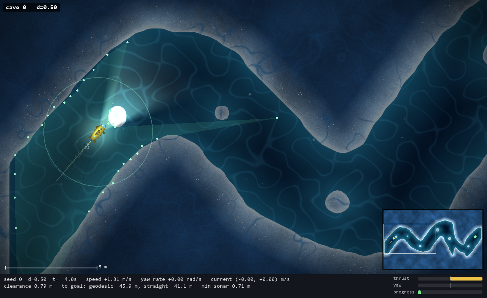
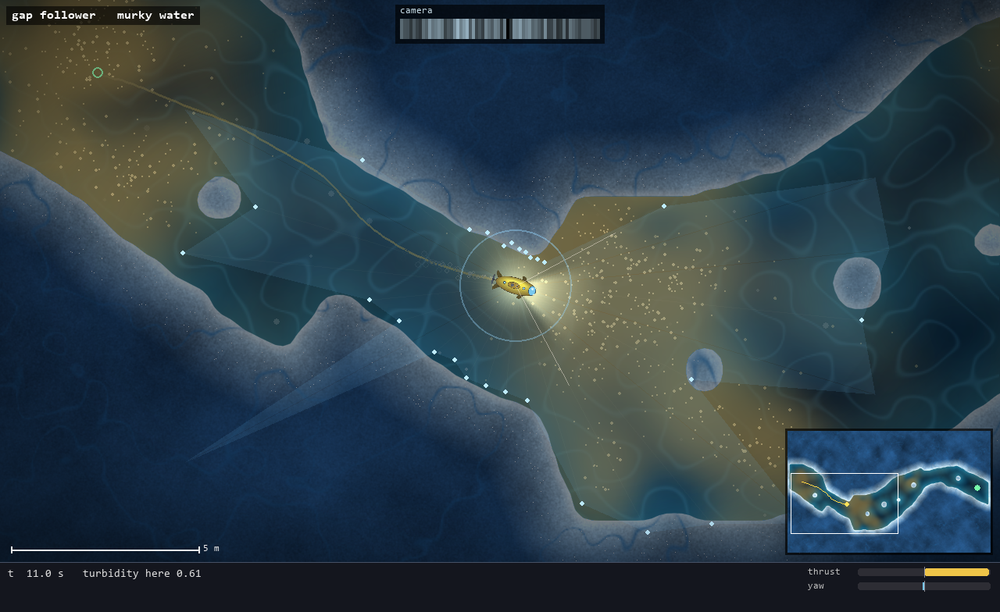
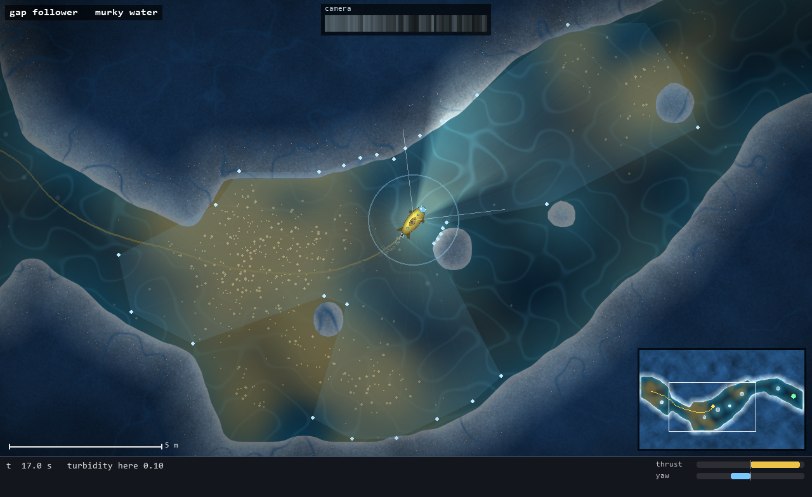
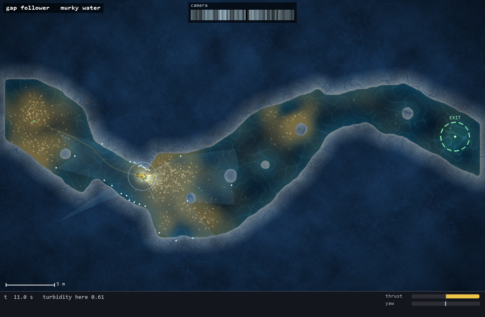
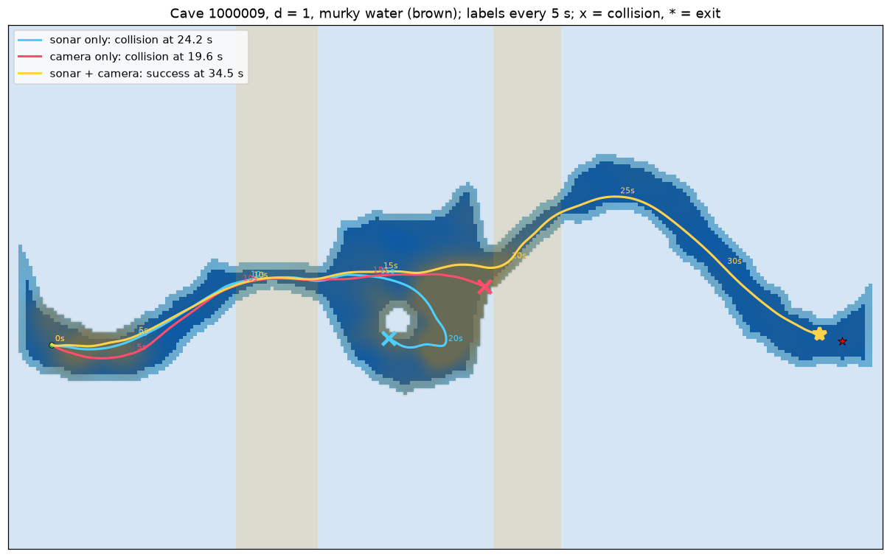
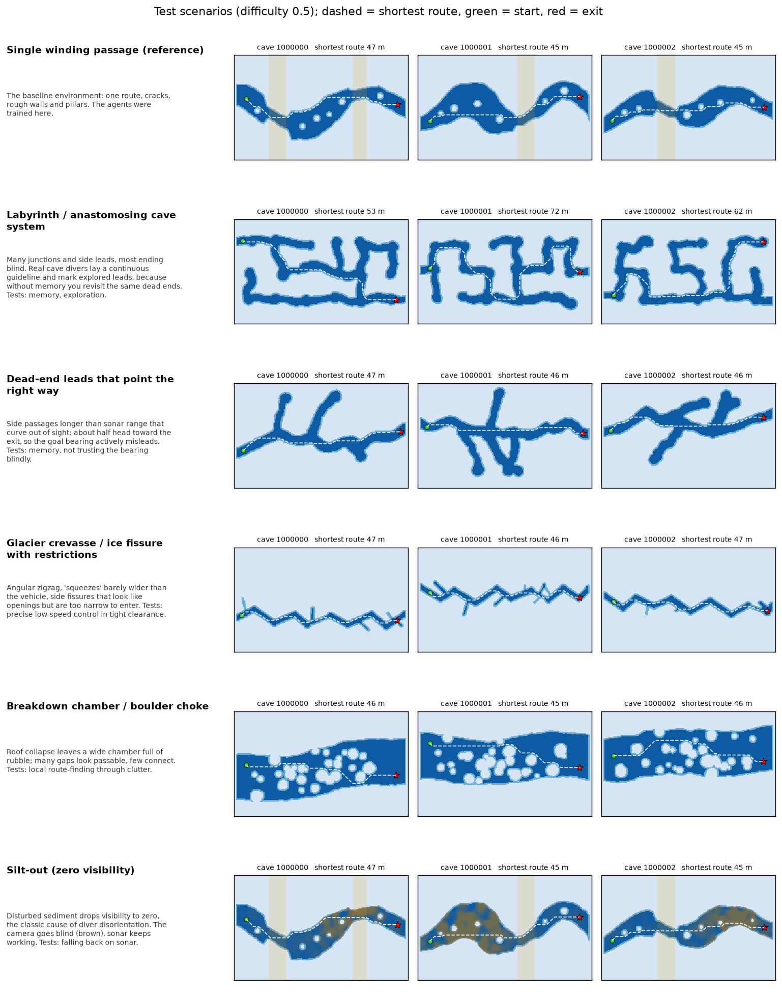

# Progress log

How the environment, the agents and the tooling evolved, stage by stage, with the measured results.
Design goals and the original plan are in [context.md](context.md); how to run everything is in [README.md](README.md);
the same story told through one example dive is in [scenarios.md](scenarios.md).

All success rates below are on **held-out test caves** (seeds ≥ 1,000,000) never seen in training,
50 caves per difficulty unless stated otherwise.

| Stage | What was added | Headline result | Videos |
|---|---|---|---|
| 0 | Python 3.12 venv, CUDA PyTorch | – | – |
| 1 | Cave generator, vehicle, sonar, Gymnasium env, baselines, evaluation | Gap follower 80% overall, **34% at d = 1**; oracle 100% | [01](videos/01_classical_baselines) |
| 2 | PPO trained on easy caves only (d = 0) | 94% on easy caves, **31% overall**: never learned to avoid obstacles | [02](videos/02_ppo_trained_on_easy_caves) |
| 3 | PPO trained on mixed difficulty | **94% overall, 82% at d = 1**, faster than the oracle | [03](videos/03_ppo_mixed_difficulty) |
| 4 | Replay videos, game-style renderer | – | [04](videos/04_game_renderer) |
| 5 | Camera model, murky water, realistic sonar | **Fused sonar + camera 93%** (86% at d = 1) vs sonar-only 88%, camera-only 84%; but no sonar fallback if the camera dies | [05](videos/05_camera_and_murky_water) |
| 6 | Test scenarios from real cave exploration (maze, dead-end branches, crevasse, boulder choke, silt-out); energy metric and penalty | Best memoryless PPO: maze **5%**, crack 70%, breakdown 60% (oracle 95–100%) | [06](videos/06_test_scenarios) |
| 7 | Retention memory (decaying attention, no LSTM) on mixed layouts | *training in progress* | – |
| 8 | Sensor-failure robustness + memory (planned) | – | – |
| – | Faster, memory-light training infrastructure | 11× faster retention updates, 2.4× faster validation, workers 1.5 GB → 58 MB | – |

---

## Stage 0: Environment setup

- Python **3.12** virtual environment in `.venv/` (3.13 was available, but 3.12 is the safer choice for PyTorch / SB3).
- PyTorch **2.14.1 + CUDA 13.0** (RTX 4060 Laptop GPU); the CPU-only build was removed.
  `requirements.txt` pins the CUDA wheel so pip doesn't pick the newer CPU-only build from PyPI.

## Stage 1: World, vehicle, sensors, environment and baselines

### Cave generator (`cave/`)
- 50 m × 30 m occupancy grid, 0.2 m cells. Centerline = sum of low-frequency sinusoids with a slope limit;
  width = base + low-frequency noise + Gaussian chambers − tapered cracks; smooth wall roughness; pillars.
- One **difficulty knob d ∈ [0, 1]** scales width (7 → 3 m), cracks (0 → 3, down to 1.7 m wide),
  roughness (0 → 0.8 m), wander (2 → 8 m) and pillar count.
- Distance transform → clearance map; **geodesic distance** to the goal by Dijkstra on a 16-connected grid
  (< 3% error vs true path length). Solvability check with regeneration from sub-seeds.
- Train / validation / test seeds in disjoint ranges (0+, 500,000+, 1,000,000+).



**Bug found:** 86% of d = 1 caves needed regeneration (260 ms per cave). A stage-by-stage diagnosis showed
pillars caused every failure: they were placed in 3 m passages where roughness then closed the gap.
Pillars now need a 1.2 m gap on each side *after* roughness, over their whole extent → 8% retries, ~8 ms per cave.

### Vehicle and sonar (`sim/`)
- Surge with linear drag (max 1.5 m/s, reverse 0.75 m/s), first-order yaw-rate lag (1 rad/s, τ = 0.3 s),
  optional constant current, disc body r = 0.4 m. 10 Hz control.
- 32-beam 360° sonar, 10 m range, ray-marched; Gaussian noise (0.05 m + 2%), 2% dropout.

### Gymnasium environment (`env/`)
- Observation (39): sonar / 10 m, speed, yaw rate, goal bearing (cos, sin) + distance, previous action.
- Reward: geodesic progress − 0.01 per step − 0.01‖Δa‖², +20 goal, −10 collision; 60 s time limit.
- Checked with both Gymnasium's and SB3's env checkers; summed progress reward verified to equal the
  geodesic distance covered exactly.

### Baselines and evaluation (`baselines/`, `evaluation/`)

| Policy | d=0 | 0.25 | 0.5 | 0.75 | 1.0 | all |
|---|---|---|---|---|---|---|
| Random | 0% | 0% | 0% | 0% | 0% | 0% |
| Wall centering | 72% | 12% | 0% | 8% | 6% | 20% |
| **Gap follower** | 98% | 92% | 86% | 88% | **34%** | 80% |
| Oracle (true map) | 100% | 100% | 100% | 100% | 100% | 100% |

The oracle at 100% proves every test cave is solvable. Gap following is strong until the hardest caves,
leaving room for learning.

**Bugs found while evaluating:**
1. Path efficiency was < 1 because episodes end 1.5 m before the goal; now divided by the distance actually covered.
2. The gap follower first scored 62%. Plotting its timeouts showed it (a) dithered in place next to pillars
   because its direction choice and speed control used different openness tests, and (b) turned back toward the
   start in wide chambers. Both now use the same vehicle-width corridor test, and the goal direction weighs more.



## Stage 2: PPO on easy caves only

- PPO, MLP 128×128, 8 parallel envs, 1M steps, trained only on d = 0 (~14 min).
- Learned fast: 100% validation success at 100k steps.

| Policy | d=0 | 0.25 | 0.5 | 0.75 | 1.0 | all |
|---|---|---|---|---|---|---|
| Gap follower | 98% | 92% | 86% | 88% | 34% | 80% |
| PPO, d = 0 only (best checkpoint) | 94% | 42% | 6% | 10% | 2% | **31%** |

**Diagnosis:** d = 0 caves are wide and nearly straight, so "follow the goal bearing at full speed" works there.
The agent never learned to use the sonar; every failure on harder caves was a collision, almost no timeouts.



## Stage 3: PPO on mixed difficulty

Changes (reward and network unchanged, so the training distribution is the only real difference):
- each episode samples d ~ U[0, 1];
- learning rate decays linearly 3e-4 → 0;
- checkpoint selection on a separate **validation** seed range (50 episodes across difficulties), never on test caves;
- 3M steps (~58 min).

| Policy | d=0 | 0.25 | 0.5 | 0.75 | 1.0 | all | time to goal |
|---|---|---|---|---|---|---|---|
| Gap follower | 98% | 92% | 86% | 88% | 34% | 80% | 35.8 s |
| PPO, d = 0 only | 94% | 42% | 6% | 10% | 2% | 31% | 30.9 s |
| **PPO, mixed** (best on validation) | 100% | 100% | 90% | 100% | **82%** | **94%** | **32.2 s** |
| PPO, mixed (final model) | 100% | 94% | 92% | 98% | 92% | 95% | 32.3 s |
| Oracle | 100% | 100% | 100% | 100% | 100% | 100% | 38.0 s |

- Mixed-difficulty training was the fix: 31% → 94% overall, 2% → 82% at d = 1.
- Faster than the oracle (it drives closer to walls); remaining failures are collisions in the tightest cracks.
- The final model looks better on d = 1 test caves, but choosing it *because* of test results would be test-set
  tuning; the validation-selected checkpoint is the reported one.



## Stage 4: Visualization

- **Replay videos** (`scripts/record.py`, `evaluation/replay.py`): several policies in lockstep on the same cave,
  same seeds as the evaluation (a test checks replays reproduce evaluation returns exactly).
- **Game-style renderer** (`sim/art.py`, `sim/viewer.py`), all procedurally generated, no image assets:
  ice / rock themes, smoothed walls, caustics, marine snow, propeller bubbles, headlight cone in dark water,
  submarine sprite, sonar pings, EXIT beacon, **follow camera with minimap**. The flat analysis view remains
  (`--style plain`). Rendering only: the simulation is identical in every style.



## Stage 5: Camera, murky water and realistic sonar

**Environment changes** (all optional; old configs and models are unaffected):

| | Before | Now (step-1 configs) |
|---|---|---|
| Sensors | sonar | sonar and/or **camera** (`sensors: [sonar, camera]`) |
| Sonar update | every 0.1 s | every **0.4 s**, held in between, plus a "scan age" input |
| Water | clear | 2–4 **murky patches** per cave (turbidity up to 1.0) |
| Observation | 39-vector | `{"camera": (1, 64), "state": (40,)}` |

- **Camera** (`sim/camera.py`): 90° FOV, 64-pixel scanline lit by the headlight. Standard underwater image
  formation: wall signal ∝ albedo · spreading · exp(−2τ), plus a backscatter veil with speckle.
  Clear water: brightness 1.00 / 0.69 / 0.29 / 0.09 at 1 / 2 / 4 / 8 m. Turbidity 1: wall contrast < 0.02.
- **Murk does not affect sonar** (sound travels through silt), so the agent should learn to lean on sonar in murk
  and on the sharper, faster camera in clear water.
- **Model:** 1D CNN on the camera (Conv1d 16-32-32, stride 2, 64 → 8 positions → 64 features) + MLP on the state
  (64 features) → PPO heads 128×128. ~91k parameters.

**How murk is rendered** (visual only; the simulation is unchanged):
- dense brown-olive silt haze (thick murk leaves ~15% of the scene visible), drifting silt clouds and suspended
  particles confined to the patches;
- in murk the headlight only reaches ~2.4 m and lights up a bright veil of silt in front of the hull, which is
  exactly the backscatter that blinds the camera; in clear water the long beam reaches the walls again;
- sonar drawn in cyan-blue so it never blends with the haze; the minimap shows the patches;
- the live camera strip (top centre) shows what the agent's camera sees: a flat grey veil inside murk.

| Inside a murky patch (turbidity 0.61) | Back in clear water (0.10) |
|---|---|
|  |  |



**Baselines under the new conditions** (30 test caves per difficulty):

| Policy | d=0 | 0.25 | 0.5 | 0.75 | 1.0 | all |
|---|---|---|---|---|---|---|
| Gap follower (0.4 s sonar) | 100% | 93% | 70% | 90% | 27% | **76%** (was 80%) |
| Oracle | 100% | 100% | 100% | 100% | 100% | 100% |

**Sensor experiment** (identical except `sensors`), 3M steps each, 50 murky test caves per difficulty:

| Policy | d=0 | 0.25 | 0.5 | 0.75 | 1.0 | all | collisions in murk* | J/m |
|---|---|---|---|---|---|---|---|---|
| Gap follower | 98% | 88% | 66% | 84% | 26% | 72% | 12% | 276 |
| PPO, camera only | 94% | 96% | 84% | 82% | 64% | 84% | **75%** | 271 |
| PPO, sonar only | 100% | 100% | 86% | 90% | 64% | 88% | 23% | 273 |
| **PPO, sonar + camera (fused)** | 100% | 100% | 88% | 90% | **86%** | **93%** | 50% | **267** |
| Oracle | 100% | 100% | 100% | 100% | 100% | 100% | – | 266 |

\* share of a policy's collisions that happened in murky water (turbidity > 0.4); every agent spends ~22% of its time there.

- **Vision helps:** fused 93% vs sonar-only 88% overall and **86% vs 64% at d = 1**. Paired on the same caves, fused
  wins 23 caves the sonar agent loses and loses 11 it wins (McNemar p = 0.058: a clear lean, just short of 5%
  significance overall); fused vs camera-only is significant (31 vs 9, p = 0.0007).
- **The camera agent fails where the physics says it should:** 75% of its collisions are inside murk although it
  spends 22% of its time there. Sonar-only collisions match its murk exposure (23% vs 22%): murk doesn't affect sonar.
- The fused agent is also the most energy-efficient learned agent (267 J/m), close to the oracle.
- Replays: `videos/05_camera_and_murky_water/sonar_vs_camera_vs_fused_d1.00_cave1000009.mp4`: on the same hard,
  murky cave the camera agent crashes in thick silt (19.6 s), the sonar agent crashes (24.2 s), the fused agent
  reaches the exit (34.5 s).

**Why the sonar-only agent detoured around the pillar** (cave 1000009, d = 1), checked against its own inputs:



1. *The goal bearing pointed into a dead-end pocket.* The chamber's exit is a narrow crack to the north-east; the
   goal lies east-south-east. At the decision point the goal bearing was −23° to +7° while the true route was +25° to
   +56° (left). Trained mostly in single tunnels, where bearing ≈ route, the agent followed the bearing.
2. *Sonar couldn't single out the exit.* 10–11 of 32 beams read > 6 m of open water in the wide chamber; the 1.7 m
   crack mouth at ~8 m spans ~12°, about one beam (11° spacing), and one long reading looks exactly like a 2% dropout.
3. *Full speed, no memory.* Thrust stayed at 1.0; by 18 s the route was behind it (+101°) and the hard turn in the
   tight pocket clipped the pillar.

The fused agent's camera (1.4° per pixel, every 0.1 s) shows the crack mouth as a clear gap between lit walls;
with its camera blanked it crashes on this cave at 9.6 s.

**Limitation found: no true sonar fallback.** Blanking the fused agent's camera (uniform grey) drops it from
43/50 to **0/50** on hard caves, although its sonar still works. In *realistic* murk it degrades gracefully: in the
silt-out scenario (one huge dense cloud, 30 caves × d ∈ {0.5, 1}) fused 82% vs sonar-only 77% vs camera-only 65%
vs gap 52%, because nearby walls still show faintly through the veil. But a dead camera (sensor failure) breaks it.
Planned fix: train with random camera failures so the network must learn to steer on sonar alone (stage 8).

## Stage 6: Test scenarios from real cave exploration, and energy

**New cave layouts** (`cave/layouts.py`, `env.layout`), each modelled on a hazard cave explorers actually face.
The original tunnel caves are unchanged (all 250 earlier test caves regenerate with exactly 0 difference).



| Scenario | Real-world situation | Tests |
|---|---|---|
| `maze` | labyrinth / anastomosing cave system: junctions and blind leads (2–7 dead ends per cave) | memory, exploration |
| `branches` | dead-end side passages longer than sonar range, about half pointing toward the exit | memory, not trusting the bearing |
| `crack` | glacier crevasse / ice fissure: angular zigzag, 1.4 m squeezes, side fissures too narrow to enter | precise control |
| `breakdown` | boulder choke after a roof collapse: wide chamber full of rubble | route-finding in clutter |
| silt-out (`configs/scenario_siltout.yaml`) | one huge, dense silt cloud across the route | sonar fallback |

**How the existing agents cope** (20 test caves each, d = 0.5, 150 s time limit):

| Scenario | Gap follower | PPO, mixed difficulty (no memory) | Oracle |
|---|---|---|---|
| Tunnel (trained here) | 90% | **95%** | 100% |
| Maze | 35% | **5%** | 100% |
| Branches | 80% | 75% | 100% |
| Crack | 5% | **70%** | 100% |
| Breakdown | 40% | 60% | 95% |
| Silt-out (sonar-only agent instead) | 75% | 85% | 100% |

- The **first crack version was unfair**: even the oracle failed 95%. It was widened (squeezes 1.4 m for a 0.8 m
  vehicle, gentler kinks) until the oracle succeeds 100%; a test nobody can pass measures nothing.
- **Maze failures are collisions (95%), not getting lost**: the agent never trained on 90° corners or junction
  chambers. Memory alone can't fix that, so step 2 trains on a mix of all layouts.

**Energy** (`EnergyConfig`): power = 300 W·|thrust|^1.5 + 120 W·|yaw|^1.5 + 60 W always-on (electronics, sonar,
lights). Reported in every evaluation (kJ per run, J per metre of route). Baseline on tunnel caves (no agent was
optimising energy yet): every agent ~12 kJ per run, 258–274 J/m; the oracle is slightly the most frugal.
It is also available as a **reward penalty** (`reward.k_energy`, per kJ; default 0 so older configs and models are
unchanged). Step 2 onwards uses `k_energy: 1.0`: a ~12 kJ run costs ~12 reward against ~+65 for a success.

## Stage 7: Retention memory (multi-scale decaying attention, no LSTM) *(end-to-end; superseded by stage 9)*

**Architecture** (`agents/retention.py`, `policy: RetentionPolicy`, `algo: recurrent_ppo`):

```
observation ──► features (MLP, or camera CNN + MLP) ──► token (64) + LayerNorm
                                                          │
       multi-scale retention, 4 heads, per-head memory matrix S (16×16) with its own decay γ:
           S_t = γ·S_{t-1} + k_tᵀ v_t      o_t = q_t · S_t     (= attention over the whole past, weights γ^age)
           γ = 0.80 / 0.95 / 0.99 / 0.999  →  half-life ≈ 0.3 s / 1.4 s / 7 s / 70 s
                                                          │
                   GroupNorm per head · output gate · residual · LayerNorm · small FFN
                                                          │
                     actor 128×128 → thrust, yaw            critic 128×128 → value
```

- No LSTM anywhere; actor and critic each have their own retention memory (~147k parameters in total).
- It plugs into sb3-contrib's RecurrentPPO through the LSTM interface (`module(seq, (h, c))`), so rollout storage,
  sequence batching and episode resets are reused unchanged.
- **Constant cost per step** whatever the memory length: acting uses the recurrent form.
- **Training uses the parallel form**: one masked attention matrix per sequence, with episode resets inside
  sequences. This made training updates **11× faster** (34 s → 3.0 s per update).
- Tests prove the recurrent update equals explicit decaying attention, and the parallel and recurrent forms agree
  exactly (including resets and a non-zero initial memory).

**Step-2 experiment** (`configs/ret_layouts.yaml` vs `configs/ppo_layouts.yaml`, identical except the memory):
mixed layouts (tunnel / maze / branches / crack / breakdown), d ∈ [0, 1], sonar every 0.4 s, energy penalty on,
150 s limit, 16 envs × 256-step sequences, 3M steps.

| Run | Status | Validation (30 mixed caves, d = 0.5) |
|---|---|---|
| `ret_layouts` (retention) | training | 23% → 33% → 20% at 100k–400k steps |
| `ppo_layouts` (memoryless) | training | 20–27% at 500k–800k steps |

**Final results** (curriculum runs `cur_mlp` / `cur_ret` / `cur_retjm`, 6M steps each, final models, 30 test caves
per cave type at d = 0.5, sonar every 0.4 s; runs archived in `runs/archive/`):

| | Maze | Branches | Tunnel | Crevasse | Boulder choke | Maze dead-end re-entries | Maze backtrack |
|---|---|---|---|---|---|---|---|
| No memory (MLP) | 13% | 83% | 20% | 53% | 53% | 0.80 | 23.1 m |
| Retention | 13% | 57% | 23% | 0% | 37% | **0.07** | **5.5 m** |
| Retention + junction memory | 10% | 60% | 20% | 13% | 17% | 0.27 | 11.5 m |

Retention memory cut dead-end re-entries ~11x and backtracking ~4x, so memory clearly changed *route*
behaviour. But success did not improve, because the agents crashed in 50-80% of plain tunnels (tunnel-only
agents managed 86-95%): one network driving at 10 Hz *and* remembering the route learned both poorly. A
collision-avoidance filter added after training cut retention's crashes (maze 60 -> 13%, tunnel 73 -> 23%), but
turned them into timeouts: the policy had never learned to drive *with* the filter. Junction memory gave no
measurable benefit end-to-end. These findings led to the two-level architecture of stage 9; the end-to-end memory
and filter code was removed (the runs remain archived).

## Stage 8: Partial observability, safety supervisor and hull damage *(components built and tested; training next)*

**Sensor failures** (`env/failures.py`, `env.failures`):

| Failure | Effect | Health flag |
|---|---|---|
| sonar total | every beam reads "open water" | yes |
| sonar dead sector (90°) | a quarter of the beams read "open water" | no: must be noticed from the data |
| camera blackout | black image | yes |
| camera frozen | the last image repeats | no |
| both | sonar total + camera blackout | yes |

Failures start at random (rates per minute), last 1–10 s, and occasionally cover a whole episode.
Evaluation can force a fixed schedule, so every policy faces identical faults.

**Tiered safety supervisor** (`env/supervisor.py`, `env.supervisor`): "stop, think, act". Designed from
cave-diving lost-line / silt-out practice, real AUV fault escalation, and Simplex / shielding in safe RL
(sources in the conversation notes):

| Tier | When | Behaviour |
|---|---|---|
| 0 normal / 1 degraded | all, or some, sensors healthy | learned policy drives |
| 2 STOP | blind (all fitted sensors flagged failed), first 3 s | brake with reverse thrust, hold heading |
| 3 ACT slowly | still blind | learned policy, speed capped at 0.2 m/s |
| 4 ABORT | blind > 30 s | hold, end as a safe abort (−5; a crash is −10) |
| recovery | any sensor healthy | back to tier 0 / 1 immediately |

Each step the supervisor changes the action costs a small penalty, so the agent learns to slow down first.
Health flags and the tier are in the observation.

**Hull damage instead of instant failure** (`env/collision.py`, `collision.mode: damage`; the default
`terminate` keeps all earlier results valid):
- A contact pushes the vehicle back out of the wall; a head-on hit keeps 20% of its speed, a glancing one most of it.
- Damage = 35 · max(0, speed into wall − 0.2 m/s)² + 1.0 · speed (abrasion), in % of hull.
- A breach at 0% ends the run (reported as a collision). The reward pays −0.1 per % of hull lost and −10 for a breach.
- A touch sensor (contact flag) and the hull integrity are in the observation.
- Calibration check, driving straight without steering: a 1.0 m/s hit costs 23% of the hull; ramming at full
  thrust breaches the hull after ~65 s; creeping into walls at ~0.1 m/s costs only 7% over 166 contacts
  (an earlier flat per-contact scrape cost cost 50% here, so abrasion was made proportional to speed).
- The intended trade-off: slow is safe but the always-on power and time penalty make it inefficient, so the
  agent has to choose its speed per situation.

Planned training (after the memory comparison picks the best memory model): failures + supervisor + hull damage
+ weak currents, with a failure curriculum.

## Stage 8 plan: generalising to sensor failures

Motivated by the stage-5 finding that the fused agent never learned a sonar fallback.

| Planned ingredient | Purpose |
|---|---|
| Random sensor failures in training: camera blackout or frozen frame, sonar dropout or dead sector, both at once; 1–10 s, occasionally a whole episode | the agent only learns strategies for situations it experiences |
| Per-sensor health flags in the observation (later ablation: without, so failures must be detected) | knowing *what* is broken |
| Retention memory (stage 7) | bridging blackouts with what it saw earlier |
| Weak water currents (≤ 0.2 m/s) | stopping isn't free, so "wait while blind" is a real decision |
| Curriculum: rare, short failures → frequent, long ones | learning each skill before the next |

Target behaviours, none hand-coded, all from the reward balance:

| Situation | Desired strategy |
|---|---|
| One sensor fails | continue on the other |
| Both fail briefly | continue on memory + own speed and heading (dead reckoning) |
| Both fail for long | slow down, hold position, wait |
| Blind in silt | move back out to regain the camera |

Evaluation: a held-out generalisation matrix (unseen caves, one layout family never trained on, longer blackouts and
stronger currents than in training), comparing the failure-trained agent with and without memory against the
current agent, the gap follower and the oracle.

## Stage 9: Two-level architecture: learned driver with a built-in safety filter, memory navigator

```
 NAVIGATOR (learned, decides at junctions / dead ends / every ~2 s)    exits from the openings detector
   retention memory (what happened) + junction memory (where)     -->  "take exit k"
 DRIVER (always on, 10 Hz)
   tracking controller (hand-written in A0, learned network in A1-A3) --> built-in SAFETY FILTER --> thrust, yaw
```

The safety filter is part of the agent, on in training and testing. The navigator never outputs thrust, so it
cannot learn wall-ramming habits, and memory only has to choose exits.

### Phase A0: hand-written driver, safety filter, openings detector (`submarine/control/`)

- **Openings detector:** exits = prominent peaks of the vehicle-width corridor reach around the scan; the way
  back is kept as "turn back"; in squeezes the deepest direction ahead reaching >= 1.5 m is offered as a *narrow*
  exit.
- **Safety filter:** predicts the stopping path (one step of the command, then braking to standstill) against
  wall points from the last two sonar scans, in the vehicle's own odometry frame (no true position); bridges
  single-beam dropouts; margin grows with speed x scan age; replaces unsafe commands with the nearest safe thrust
  level, then gentler turns.
- **Hand controller:** steers toward the most open corridor near the commanded exit (so it follows the passage),
  side-wall repulsion, speed from the distance ahead with drag feed-forward.

**Audits that changed the design** (each found by checking against the true map or tracing failures):

| Found | Cause | Fix |
|---|---|---|
| Exits in 2 m passages dropped | a 2 m passage is one beam wide once the vehicle width counts | minimum 1 beam |
| Open chambers reported as dead ends | the whole circle was one open run, its deepest direction pointing backwards | exits = prominent reach peaks |
| True route missing in crevasses (79% recall) | 1.1 m corridor too strict for zig-zag cracks | 0.9 m corridor, prominence 2.5 m: recall 85-96% in all cave types |
| 21 of 34 crevasse turn-backs were false dead ends | no straight 3 m corridor in a zig-zag | *narrow* exits (>= 1.5 m, within +-45 deg): 8 false, maze dead ends still detected 28/32 |
| 20 ms per step | look-ahead of 10 candidates x 40 steps in NumPy | scalar path for the requested command first, lazy fallbacks, unqueried lower bound: same decisions (tested), 4 ms |
| Crash on a turn-back at 0.8 m/s (phase B) | a hard turn while moving sweeps the hull into a side wall; only thrust was filtered | the filter also softens the turn |

**Gate** (30 test caves per cave type, d = 0.5, sonar every 0.4 s, scripted memoryless navigator):

| | Tunnel | Maze | Branches | Crevasse | Boulder choke |
|---|---|---|---|---|---|
| Driver: success / collisions | **100% / 0%** | 60% / 0% | **97% / 0%** | **80% / 0%** | 67% / 0% |
| Gap follower: success / collisions | 70% / 30% | 33% / 67% | 77% / 23% | 3% / 90% | 43% / 53% |
| Filter intervened (driver) | 3.3% of steps | 2.5% | 1.4% | 13.4% | 3.6% |

Zero collisions in all 150 dives. The remaining timeouts are route choice by the memoryless teacher (maze dead
ends), which is the navigator's job.

### Phases A1-A3: learned driver (`configs/driver.yaml`, `scripts/train_driver.py`)

- Input (77): sonar now + previous scan, scan age, speed, yaw rate, command (bearing, speed), last applied action,
  filter flag, contact / hull / sonar health / supervisor tier. No goal, no map. Output: thrust, yaw; then the filter.
- Reward: metres along the commanded heading, - overspeed, - filter override, - jerk, - energy, - hull damage.
- **A1 imitation** of the hand controller (200k steps, noise on executed actions, clean labels; value head
  pretrained on returns): action MSE 0.0225. Imitation-only driver: tunnel 100%, crevasse 50% (hand 70%), 0 crashes.
- **A2** PPO curriculum (tunnels -> all cave types + slow sonar + currents -> full difficulty), **A3** robustness
  (sensor failures, blindness supervisor, hull damage). 6M PPO steps, 2.6 h; episode reward per stage 25.4 / 20.9 /
  18.3 / 20.4. Most of the skill came from imitation; PPO fine-tuned it (reward +7-15% within the first two stages).
- **Gate** (same 150 test dives as A0):

  | | Tunnel | Maze | Branches | Crevasse | Boulder choke |
  |---|---|---|---|---|---|
  | Hand driver: success / collisions | 100% / 0% | 67% / 0% | 97% / 0% | 80% / 0% | 63% / 0% |
  | Learned driver: success / collisions | 100% / 0% | 67% / 0% | 97% / 0% | 87% / 0% | 50% / 0% |
  | Filter intervened (hand -> learned) | 3.5 -> 6.7% | 2.7 -> 2.8% | 1.5 -> 1.1% | 13 -> 16% | 3.9 -> 5.3% |

  Zero collisions and zero hull contacts for both. Paired by cave, the hand driver alone succeeded in 9 caves and the
  learned one alone in 7: no significant difference (boulder choke 6 vs 2, p ~ 0.3). The learned driver is faster in
  crevasses (0.89 vs 0.75 m/s) and leans on the filter a little more. Used for phase B.
- Speed work: workers step 4 envs each (a vector step waits for the slowest worker: rare 10 ms steps and 180 ms
  cave generations of any one env otherwise set the pace), scalar map interpolation (bit-identical): 500 -> ~1,300
  steps/s.

### Phase B: navigators (`configs/navigator.yaml`, `scripts/train_navigator.py`)

- One step = one decision; Discrete(5): four exits + turn back. Observation (61): exits (bearing, navigation-frame
  heading, depth, width, narrow), goal cue, dead-reckoned pose, previous decision (pose, heading, at junction?),
  junction / dead-end flags, health, hull. Reward: the CaveEnv reward summed over the driving in between.
- Navigators: none (MLP), **retention** (4 heads, decays 0.5/0.8/0.95/0.99 *per decision*), **retention + junction
  memory** (8 slots keyed by dead-reckoned position; written when leaving a junction and at dead ends; read by
  attention with a distance penalty). Same config, curriculum and budget (180k decisions, about 3,600 dives).
- Training (three in parallel, 8 workers each): none 67 min, retention 103 min, junction memory 145 min. Final-stage
  episode reward: none 20.0, retention 4.1, junction memory 4.3.

**Test results** (30 held-out caves per cave type, d = 0.5, sonar every 0.4 s, learned driver; `scripts/eval_navigator`):

| Success | Tunnel | Maze | Branches | Crevasse | Boulder choke | All |
|---|---|---|---|---|---|---|
| Random exits | 0% | 0% | 0% | 0% | 0% | 0% |
| Greedy heuristic (exit nearest the goal cue) | 100% | **67%** | **100%** | 90% | 60% | **83%** |
| Navigator, no memory | 100% | 57% | 90% | **100%** | **63%** | 82% |
| Navigator, retention | 100% | 20% | 60% | 97% | **67%** | 69% |
| Navigator, retention + junction memory | 100% | 27% | 77% | **100%** | 57% | 72% |

Maze dead-end entries / re-entries per dive: greedy 1.33 / 0.50, none 1.47 / 0.43, retention 1.53 / 0.40, junction
memory 1.60 / 0.60.

- **Safety held:** 1 hull breach in 750 navigator test dives (retention, crevasse), 0 for every other navigator
  including random exit choice. The end-to-end agents of stage 7 crashed in 13-60% of mazes.
- **Memory did not help; it hurt.** Neither memory navigator reduced dead-end entries or re-entries, and both lost
  success in mazes and branches.

**Why (diagnosed from action distributions and the memory replays, `scripts/nav_videos.py`):**

1. **A free "carry on" action.** Choosing an empty exit slot keeps the current heading for a 0.1 penalty. At maze
   junctions the memoryless navigator puts 38% of its probability there (and 39% on the rightmost exit: a crude
   wall-following rule that works reasonably); retention puts 64% there. At a dead end, "carry on" means pressing
   into the wall until the episode times out: the retention replay of maze cave 1000000 sits at the end of the first
   dead end from 20 s to 150 s. The recurrent model, with noisier gradients, fell into this default hardest.
2. **The junction memory recalls but does not act.** In the same cave the junction-memory navigator stores the dead
   end and recalls it with 100% attention at every decision for 16 s, yet keeps choosing to press on.
3. **Duplicate writes evict useful memories.** Each decision at a dead end writes the dead end again (the flag is
   set at every decision there). Within 15 s the same dead end filled all 8 slots and every junction memory was
   overwritten (replay at 70 s: "0 junctions, 8 dead ends stored").
4. **The crash:** pressing forward at a crevasse bend while already inside the filter's 0.52 m floor (measured 0.45 m).
   There the filter only forbids getting closer *as seen by sonar*; the wall corner fell between two of the 32 beams
   and the hull touched at 0.33 m/s.

The memory replays are verified against the agent's state: every displayed memory matches a write event (26 writes,
0 unexplained in maze cave 1000000).

### Phase B round 2: the fixes, retrained (`runs/nav_*_v2`)

**Fixes** (commit `913e292`, all with tests):
1. An empty exit slot now means the nearest real exit, or turn back at a dead end (`empty_slot: remap`). There is
   no "carry on regardless".
2. A junction-memory write within 2 m of a stored slot updates that slot.
3. Every navigator is warm-started by imitating a map-aware teacher (`OracleNavigator`: marches along each exit
   on the true shortest-path field). The demonstrations were 40k decisions on training caves, with 18% random
   wrong turns executed; they also trained the value head. Held-out agreement with the teacher: 93% (none) and
   92% (both memory navigators).
4. Safety filter: inside the 0.52 m floor, forward speed is capped at 0.2 m/s.

**Driver gate with the patched filter** (150 dives each): 0 collisions, 0 contacts. Learned driver: crevasse
87 → 90%, boulder choke 50 → 57%, others unchanged; slightly slower in crevasses (0.89 → 0.83 m/s).

**Test results** (30 held-out caves per type, d = 0.5; greedy re-run with the patched filter):

| Success | Tunnel | Maze | Branches | Crevasse | Boulder choke | All 150 |
|---|---|---|---|---|---|---|
| Oracle (true map; the teacher) | 100% | 100% | 100% | 100% | 80% | 96.0% |
| Greedy heuristic | 100% | 70% | 97% | 90% | 53% | 82.0% |
| No memory, round 2 | 100% | 77% | 97% | 90% | 53% | 83.3% |
| **Retention, round 2** | 100% | **83%** | 97% | **93%** | **70%** | **88.7%** |
| Retention + junction memory, round 2 | 100% | 67% | 93% | 93% | 50% | 80.7% |
| *Round 1: none / retention / junction* | | *57 / 20 / 27%* | | | | *82 / 69 / 72%* |

Maze, per dive:

| | Dead-end entries | Re-entries | Backtracking |
|---|---|---|---|
| Greedy | 1.27 | 0.40 | 20.8 m |
| No memory | 1.23 | 0.33 | 19.7 m |
| **Retention** | **1.07** | **0.13** | **17.5 m** |
| Junction memory | 1.23 | 0.33 | 21.3 m |

Paired by cave (sign test over the 150 caves):

| Comparison | Caves only the first solved | Caves only the second solved | p |
|---|---|---|---|
| Retention vs greedy | 11 | 1 | **0.006** |
| Retention vs junction memory | 14 | 2 | **0.004** |
| Retention vs no memory | 11 | 3 | 0.057 |
| Junction memory vs no memory | 5 | 9 | 0.42 |

- **Memory now helps.** Retention is the best navigator: 88.7%, against 83.3% without memory and 82.0% for
  greedy. It re-enters maze dead ends 2.5× less often than the memoryless navigator. In round 1 it was the worst
  (69%).
- **Junction memory still adds nothing** over no memory (80.7% vs 83.3%, not significant), and it does worse
  than plain retention, which it contains. Its position-keyed slots and attention read give the policy one more
  vector to decode, and nothing trains what goes into them. That is the motivation for the `memory-v3` branch:
  per-exit reads, auxiliary losses, and scenarios that need memory.
- **0 hull breaches in 600 navigator test dives** after the creep cap (round 1: 1 in 750).
- **The remaining gap to the teacher** (96%) is in mazes and boulder chokes.

Comparison replays: every navigator on the same hardest cave per type, plus maze cave 1000000, in
`videos/08_round2/` (see its README).

## Training infrastructure and speed

**Memory crashes and their fixes.** Running several trainings at once crashed three times. Each time the cause was
memory commit on Windows, never the RAM itself:

| Cause | Cost | Fix |
|---|---|---|
| SB3 `SubprocVecEnv` workers each load PyTorch with CUDA | ~2 GB per worker | `LightSubprocVecEnv` (`agents/light_vec_env.py`, `env/vec_worker.py`): workers that only run the NumPy simulator; verified step-for-step identical to a local env; default `vec_env: light` |
| NumPy's BLAS reserves a buffer per CPU thread (32 here) in every process | ~1.5 GB per process | cap BLAS threads: 1 per worker, 4 per learner / evaluator / recorder |
| SB3's `VecMonitor` asks workers "are you wrapped in `Monitor`?" by sending the `Monitor` class, whose unpickling imports SB3 + PyTorch + CUDA in every worker | ~870 MB per worker | the worker pool answers locally (`env_is_wrapped`); a test checks workers stay PyTorch-free through the full training path |
| Evaluation pool of 6 PyTorch processes started together with two trainings | – | evaluation with 2 workers; pipelines launch runs only after the previous stage, verify that each run saved a final model, and start runs 60 s apart |

Result: two 16-env trainings with validation pools (52 processes) use **5.3 GB** in total, ~58 MB per worker.
The same two runs used ~16 GB before the last fix.

**Speed measurements** (fused camera + sonar config):

| Component | Time |
|---|---|
| One env step (sensors + physics) | 0.84 ms (camera 0.24 ms, sonar scan 0.21 ms every 4th step) |
| PPO update, batch 256, CPU / GPU | 4.4 s / 6.4 s (GPU slower: network too small) |
| PPO update, batch 2048, CPU / GPU | 2.0 s / **0.7 s** |
| Validation, 15 episodes, sequential / parallel workers | 17.8 s / 7.4 s (**2.4×**, identical results) |

**Batch-size A/B check** (`configs/ab_batch256.yaml` vs `configs/ab_batch2048.yaml`, sonar-only murky setup,
identical except batch size and device; the GPU arm was stopped at 500k steps):

| Steps | Batch 256, CPU | Batch 2048, GPU |
|---|---|---|
| 100k | 34% | 30% |
| 200k | 42% | 44% |
| 300k | 48% | 38% |
| 400k | 42% | 44% |
| 500k | 40% | 42% |
| Wall-clock speed | **1,358 steps/s** | 499 steps/s |

- Learning per step is the same for both batch sizes.
- The GPU arm is **2.7× slower** end to end: its updates are faster, but choosing actions for 8 envs one step at a
  time costs more on the GPU than computing them on the CPU. With networks this small, **training stays on CPU**;
  batch 2048 on CPU (update 2.0 s vs 4.4 s) is the safe speed-up for future runs.
- The retention policy shows the same pattern: GPU updates are faster, but acting step by step on the GPU is slow
  (7.9 s vs 3.2 s per rollout), so it also trains on CPU.

---

## How the observation and model grew

| Stage | Observation | Policy network | Training data |
|---|---|---|---|
| 2 | 39 values (sonar, speed, yaw rate, goal, previous action) | MLP 128×128 (44k params) | d = 0, 1M steps |
| 3 | same | same | d ~ U[0, 1], 3M steps, decaying LR |
| 5 | camera (1×64) + 40 values (adds sonar scan age) | 1D CNN + MLP → 128×128 (91k params) | d ~ U[0, 1] + murk, 3M steps |
| 7 | 40 values (sonar every 0.4 s) | **retention memory** → 128×128 (147k params) | mixed layouts, d ~ U[0, 1], energy penalty, 3M steps |
| 7 (control) | same | MLP 128×128 (44k params) | same |

## How the reward grew

| Stage | Reward |
|---|---|
| 2–5 | geodesic progress − 0.01/step − 0.01‖Δa‖² + 20 goal − 10 collision |
| 7 onwards | the same − 1.0 × energy used (kJ) |

## Next

1. Memory v3 (branch `memory-v3`, see `docs/memory_v3.md` there): exit memory with per-exit reads, auxiliary
   losses (loop closure, taken, known dead end), memory scenarios (`decoy`, `loops`, blind dives), and four
   variants (none / GRU / graph / exit).
2. Planned extension: place memory + speed modes (faster through sections already passed safely), return-to-base
   scenario.
3. LSTM comparison against retention; curate `videos/` once the memory navigators are confirmed in complex caves.
